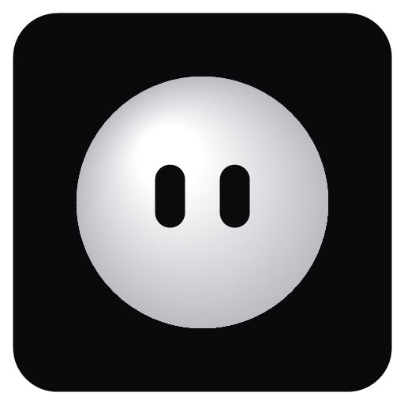
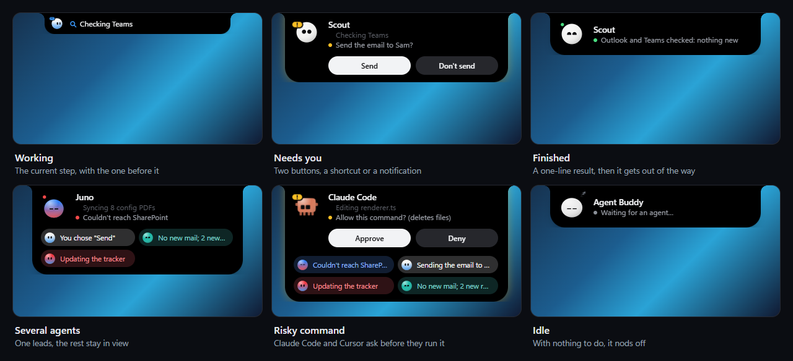
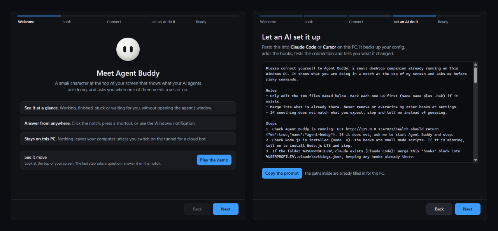
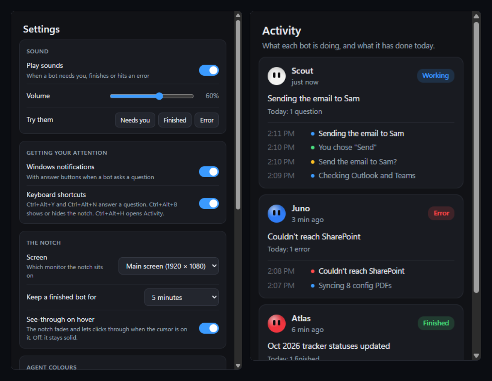

<div align="center">



# Agent Buddy

**A small character at the top of your Windows screen that shows what your AI agents are doing, and asks you when one of them needs a yes or no.**

Works with Claude Code, Cursor, Grok Bot, and anything that speaks MCP.

[Download](../../releases/latest) · [Quick start](#quick-start) · [Connect an agent](#connect-an-agent) · [Let an AI set it up](docs/SETUP-WITH-AI.md)

<br />



</div>

## Why

Agents work for minutes at a time, and you end up checking their window to see whether they are done, stuck, or waiting for you. Agent Buddy keeps that answer on screen: a black notch at the top centre of your display, with a character that works, celebrates, frets and dozes along with your agents.

- **See it at a glance.** Each agent's current step, the one before it, how long it has been going, and whether it has gone quiet.
- **Answer from anywhere.** When an agent asks, answer on the notch, with `Ctrl+Alt+Y` / `Ctrl+Alt+N`, or from the Windows notification. Typed answers and "always answer this way" are there too.
- **Several agents at once.** One leads, the rest stay in view. Each has its own colour, and Claude Code and Cursor get their own character.
- **Out of your way.** Move the cursor onto the notch and it turns see-through and lets clicks through. Touch the character's face to wake it.
- **Private by default.** A local server on `127.0.0.1`. Nothing leaves your PC unless you switch on the tunnel for a cloud bot.

## Quick start

1. Download `AgentBuddy-Setup-x.y.z.exe` from [Releases](../../releases/latest) and run it. The installer is not code-signed, so Windows SmartScreen will warn: choose **More info**, then **Run anyway**.
2. The **Quick start** window opens on first launch. It plays a demo, lets you set the look, and walks you through connecting an agent.
3. Or skip the clicking: copy the prompt from the **Let an AI do it** step, paste it into Claude Code or Cursor, and it connects itself. See [docs/SETUP-WITH-AI.md](docs/SETUP-WITH-AI.md).



Agent Buddy lives in the system tray. Right-click its icon for everything: Quick start, Settings, Activity, Do not disturb, and Connect an agent.

## Connect an agent

| Agent | How it connects | What you get |
|---|---|---|
| **Claude Code** | Hooks in `%USERPROFILE%\.claude\settings.json` | Every step shown; a question before risky commands |
| **Cursor** | Hooks in `%USERPROFILE%\.cursor\hooks.json` | Shell commands and edits shown; a question before risky commands |
| **Grok Bot and other cloud bots** | A custom connector through a secure tunnel, plus a short skill for each bot | Status and questions from bots that run on someone else's servers |
| **Anything with MCP** | Add the local MCP server | Two tools: `set_status` and `ask_user` |

The tray menu and the Quick start window copy the exact config for each, with the paths filled in for your PC. Step-by-step instructions, including a fixed tunnel address, are in [docs/CONNECTING.md](docs/CONNECTING.md).

Claude Code and Cursor hooks are small Node scripts, so those two need [Node.js](https://nodejs.org) installed. They fail open: if Agent Buddy is not running, your agent carries on as normal.

### The two tools

```jsonc
// What the agent is doing. state: working | finished | error | upload | idle | greeting
set_status { "state": "working", "message": "Updating the tracker", "next": "Email the summary", "agent": "Scout" }

// Ask the person and wait. Two buttons, or free_text for a typed answer.
ask_user { "question": "Send the email to Sam?", "options": ["Send", "Don't send"], "agent": "Scout" }
```

You can try it without any agent:

```powershell
Invoke-RestMethod http://127.0.0.1:47821/api/status -Method Post -ContentType 'application/json' -Body '{"state":"working","message":"Hello from PowerShell","agent":"Scout"}'
```

## Make it yours



- **Settings:** which screen, see-through on hover, sounds and volume, notifications, shortcuts, how long a finished agent stays, a colour per agent, and start with Windows.
- **Activity** (`Ctrl+Alt+H`): what every agent is doing now and what it has done today.
- **Do not disturb:** no sounds or notifications, and the notch stays small. Questions still show.
- **Remembered answers:** choose "Always…" under a question and that agent's same question is answered for you from then on. Forget one in Settings.

| Shortcut | Does |
|---|---|
| `Ctrl+Alt+Y` / `Ctrl+Alt+N` | Answer the question on screen (first / second button) |
| `Ctrl+Alt+B` | Show or hide the notch |
| `Ctrl+Alt+H` | Open Activity |

## Security

- The server binds to `127.0.0.1` only and refuses any request that comes from a web page.
- Requests through the tunnel can reach only the MCP endpoint, and only with a secret token (stored with Windows DPAPI, rotatable from the tray). They are rate-limited.
- The notification buttons carry a one-time code, so a link on a web page cannot answer a question for you.
- The risky-command check for Claude Code and Cursor errs towards asking. It is a convenience, not a sandbox.

More in [SECURITY.md](SECURITY.md).

## Build from source

Needs Windows 10 or 11, [Node.js](https://nodejs.org) 20 or newer, and git.

```powershell
git clone https://github.com/Bryson-he/agent-buddy.git
cd agent-buddy
npm install
npm start
```

| Command | Does |
|---|---|
| `npm start` | Build and run |
| `npm run dev` | The same, with DevTools |
| `npm run dist` | Build the installer into `release\` |
| `npm test` | Build, then run the Ask Grok tool-loop test |
| `node scripts/test-risky.mjs` | Risky-command rules |
| `node scripts/test-hooks.mjs` | The real hook scripts against a fake Agent Buddy |
| `npx electron . --snapshot-dir=shots` | Save a picture of every state and window, then exit |

`CLAUDE.md` is a map of the code for AI assistants and people alike. Note that Windows only is supported today; the overlay and notifications rely on Windows behaviour.

## Credits

The idea of a companion character that lives outside the app comes from Novra's concept case study, [Taking Grok Bot outside the app](https://www.novra.design/case-studies/grokbot). That concept describes a look for Mac and iPhone; this project is an independent Windows app with its own drawings, animation and code, and everything about connecting to agents is original to it.

Agent Buddy is not affiliated with or endorsed by xAI, Anthropic, Anysphere (Cursor), Cloudflare or Novra. Product names belong to their owners.

## Licence

[MIT](LICENSE).
